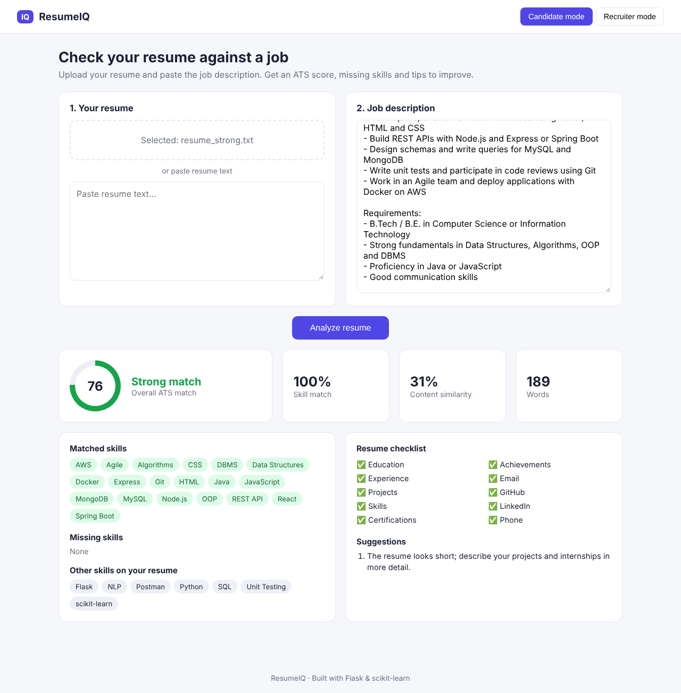

# ResumeIQ: AI Resume Screener & ATS Score Analyzer

   



ResumeIQ compares a resume against a job description the way an Applicant Tracking System (ATS) does. It gives an **ATS match score**, the **skills you match and miss**, a **resume checklist**, and **tips to improve**. Recruiters can also upload many resumes and **rank candidates** for a role.

## Features

- **Candidate mode**: upload a resume (PDF / DOCX / TXT) or paste text, paste a job description, and get:
  - Overall ATS score (0–100) with a verdict (Strong / Good / Partial / Weak match)
  - Matched, missing and extra skills from a taxonomy of 90+ skills
  - Section check (Education, Projects, Skills, Experience...) and contact check (Email, Phone, LinkedIn, GitHub)
  - Personalised suggestions (action verbs, quantified impact, length, missing sections)
- **Recruiter mode**: upload several resumes and rank them against one job description
- **REST API** that other apps can call
- 20 automated tests (pytest) and GitHub Actions CI
- Docker support

## How the score works

```
ATS score = 0.65 × Skill match + 0.35 × Content similarity
```

| Signal | Technique |
|---|---|
| **Skill match** | Rule-based NLP: skills are extracted with regex over a skill taxonomy with aliases (e.g. `reactjs` → React, `sklearn` → scikit-learn). Score = matched JD skills ÷ total JD skills. |
| **Content similarity** | Both texts are turned into **TF-IDF vectors** (unigrams + bigrams, English stop words removed) and compared with **cosine similarity**. |

## Tech stack

| Layer | Technology |
|---|---|
| Backend | Python, Flask (app factory + blueprints) |
| ML / NLP | scikit-learn (TfidfVectorizer, cosine_similarity), regex |
| File parsing | pypdf, python-docx |
| Frontend | HTML, CSS, vanilla JavaScript (Fetch API) |
| Testing / DevOps | pytest, GitHub Actions, Docker, Gunicorn |

## Project structure

```
resumeiq/
├── app.py                 # Entry point
├── resumeiq/
│   ├── __init__.py        # Flask app factory
│   ├── routes.py          # Web UI + REST API
│   ├── analyzer.py        # Scoring, skill extraction, suggestions
│   ├── parser.py          # PDF / DOCX / TXT text extraction
│   └── skills.py          # Skill taxonomy
├── templates/index.html
├── static/ (style.css, app.js)
├── samples/               # Sample resumes and job description
└── tests/                 # pytest test suite
```

## Run locally

```bash
git clone https://github.com/<your-username>/resumeiq.git
cd resumeiq
python -m venv venv
source venv/bin/activate        # Windows: venv\Scripts\activate
pip install -r requirements.txt
python app.py
```

Open http://localhost:5000. Try the files in `samples/`.

Run the tests:

```bash
pytest -q
```

Run with Docker:

```bash
docker build -t resumeiq .
docker run -p 5000:5000 resumeiq
```

## API

| Method | Endpoint | Body | Returns |
|---|---|---|---|
| GET | `/api/health` | – | Status and version |
| POST | `/api/analyze` | JSON `{resume_text, job_description}` or form-data with `resume` file + `job_description` | Full analysis |
| POST | `/api/rank` | form-data: multiple `resumes` files + `job_description` | Ranked candidates |
| POST | `/api/skills` | JSON `{text}` | Skills found in the text |

Example:

```bash
curl -X POST http://localhost:5000/api/analyze \
  -H "Content-Type: application/json" \
  -d '{"resume_text": "Java developer with React, MySQL and Git ...", "job_description": "Looking for a Java full stack developer ..."}'
```

## Future improvements

- Sentence-embedding similarity (e.g. Sentence-BERT) for semantic matching
- Learn skill weights from real hiring data
- Export the report as PDF

## Author

**D. Thirupathi**, B.Tech Information Technology
